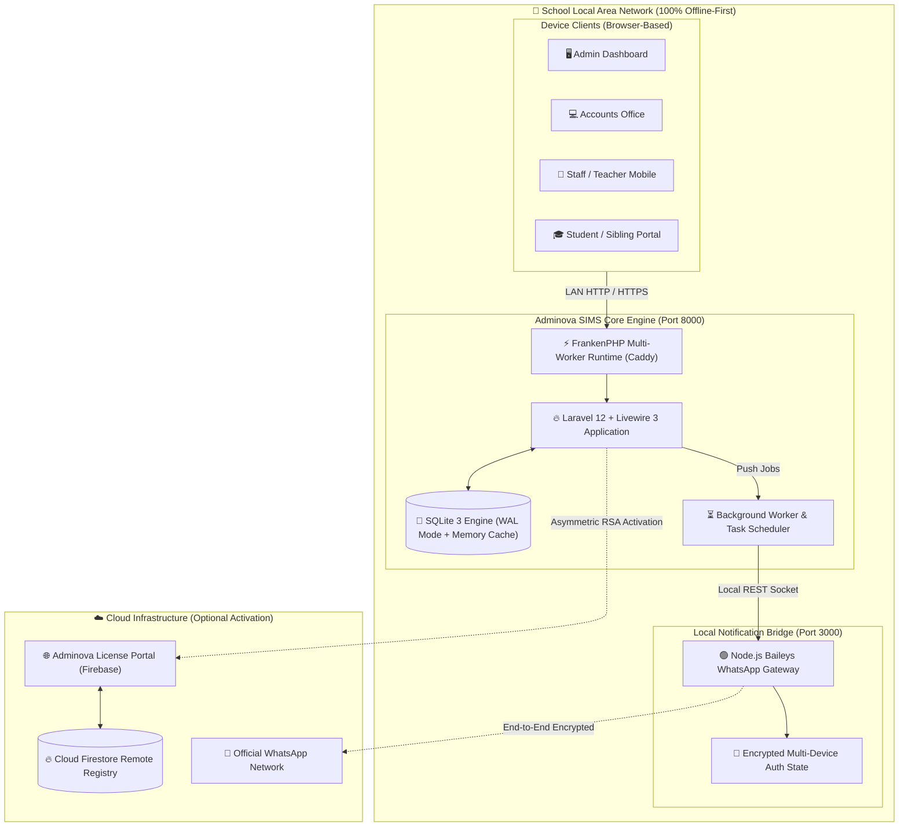
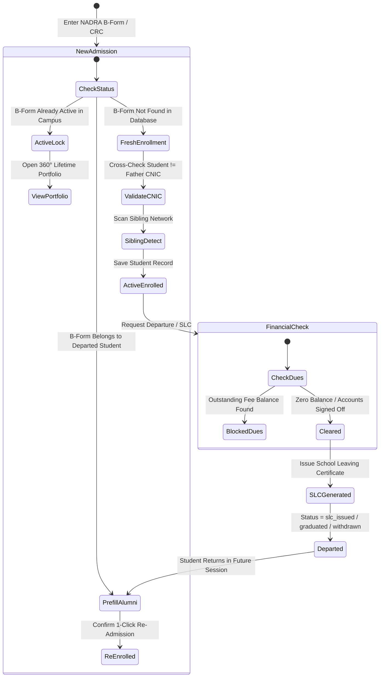
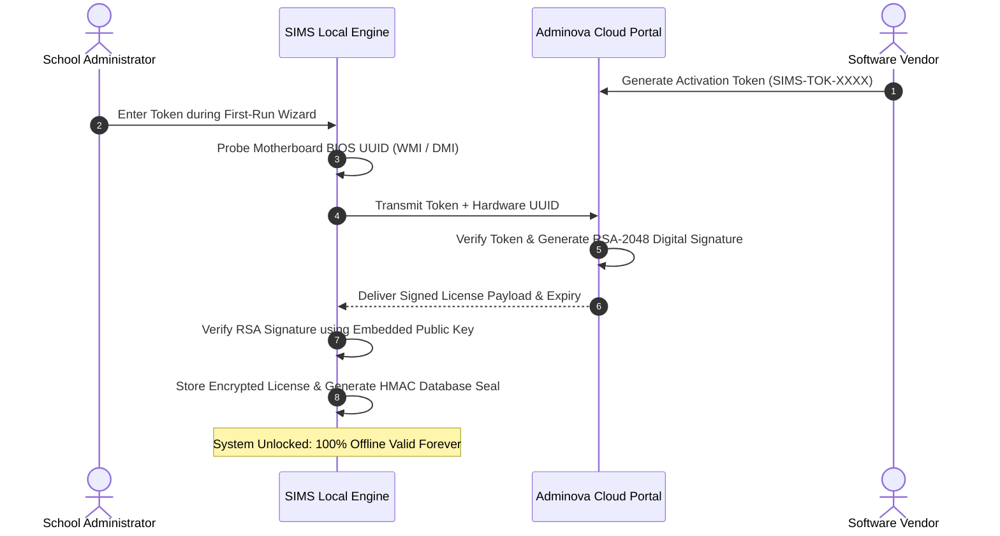

# Adminova SIMS (School Information Management System)

<div align="center">

[](https://github.com/saimimran87678-web/sims-app/releases/tag/v2.6.0)
[](https://laravel.com)
[](https://livewire.laravel.com)
[](https://php.net)
[](https://tailwindcss.com)
[](https://sqlite.org)
[](https://frankenphp.dev)
[](pricing.html)
[-brightgreen.svg?style=for-the-badge&logo=githubactions)](sims-app/tests)

**High-Performance, 100% Offline-First Campus Management & Institutional ERP Platform**

*Engineered for primary, secondary, and higher-secondary institutions, model colleges, and multi-shift campuses.*

[Key Features](#-key-features--subsystems) • [Architecture](#-system-architecture) • [Student Lifecycle & Security](#-student-lifecycle-slc-issuance--alumni-re-admission) • [Quick Start](#-quick-start--installation) • [CLI Management](#-global-cli-management-sims-tool) • [Licensing & Security](#-hardware-locked-licensing-engine) • [Pricing Models](#-commercial-editions--pricing)

</div>

---

## 📖 Overview

**Adminova SIMS** is a production-grade, enterprise School Information Management System built specifically to eliminate internet dependency while delivering sub-second reactive web speeds (<400ms page transitions). 

Traditional cloud school portals suffer from high latency, recurring per-SMS telco bills, privacy risks, and total operational shutdown during internet outages. Adminova SIMS solves this with:
- **100% Offline-First Local LAN Architecture** powered by **FrankenPHP** worker runtimes and **SQLite Write-Ahead Logging (WAL)**.
- **NADRA B-Form / Child Registration Certificate (CRC) Identity Verification** with anti-collision validation between student and parent CNICs.
- **Complete Institutional Student Lifecycle**: Audited departures, financial dues clearance verification, tamper-evident School Leaving Certificates (SLC), 360° Lifetime Student Portfolios, and 1-click returning alumni re-admission.
- **Zero-Cost WhatsApp Notification Gateway** bypassing third-party SMS aggregators for fee receipts, morning absence alerts, and announcements.
- **Mathematical Master Timetable & Daily Teacher Substitution Balancer** that resolves absences in under 5 seconds.
- **Standard 3-Part Bank Challan Engine** (Bank Copy, School Copy, Student Copy) with real-time partial payment tracking and fee concessions.

```
┌─────────────────────────────────────────────────────────────────────────────┐
│                             ADMINOVA SIMS v2.6.0                            │
│                                                                             │
│   ⚡ <400ms Sub-Second Speed         │   📶 100% Offline-First Local LAN    │
│   🆔 NADRA B-Form Identity & CRC    │   📜 School Leaving Certificate (SLC)│
│   🔄 1-Click Returning Alumni System │   💳 3-Part Bank Fee Challans        │
│   📲 Automated WhatsApp (Zero Cost)  │   🗓️ Timetable & Substitution Engine │
│   👨‍👩‍👧‍👦 Real-Time Sibling Network       │   🔐 Motherboard BIOS RSA-2048 Lock  │
└─────────────────────────────────────────────────────────────────────────────┘
```

---

## 🏛️ System Architecture

Adminova SIMS runs on campus hardware as a self-contained local server, accessible across the local network (LAN / Wi-Fi) by administrators, accountants, teachers, and students.



---

## 🚀 Key Features & Subsystems

### 🎓 1. Institutional Student Lifecycle, SLC & Alumni Management (v2.6.0)
- **State Machine Audited Departures:** Formal transition handling between `active`, `withdrawn`, `slc_issued`, `graduated`, and `struck_off`.
- **Mandatory Financial Clearance Gate:** The system automatically checks outstanding fee balances and uncollected dues prior to allowing withdrawal or certificate generation.
- **Automated School Leaving Certificate (SLC):** Generates official, tamper-evident SLC documents with auto-incrementing serial numbers, conduct evaluations, attendance percentages, departure reason, and principal sign-off blocks.
- **360° Lifetime Student Portfolio & Audit Timeline:** Interactive real-time modal presenting the student's complete historical journey:
  - Demographic & family identification.
  - Multi-session academic progression and class enrollments.
  - Complete fee transaction ledgers and payment receipts.
  - Lifetime attendance rates and chronological audit log entries.
- **1-Click Returning Alumni Re-Admission:**
  - Instantly detects previously departed students when entering their NADRA B-Form / CRC.
  - Prefills historical demographic data with fields locked against accidental tampering.
  - Preserves the student's permanent ID and lifetime audit trail while creating a clean enrollment for the active academic session.
- **Active Student Duplicate Admission Lockout:**
  - Blocks duplicate enrollment if a student with the same B-Form is already active in the institution.
  - Highlights an urgent, high-contrast notification card with the student's current class/section and a 1-click link to view their 360° Lifetime Portfolio.

### 🆔 2. NADRA B-Form/CRC Identity & Family Security (v2.6.0)
- **Pakistani National Identity Standards:** Validates 13-digit NADRA B-Form / Child Registration Certificate (CRC) and CNIC numbers with automatic dash formatting (`XXXXX-XXXXXXX-X`).
- **Cross-Identity Collision Defense:** Guarantees that a student's B-Form/CNIC can never match the Father's or Guardian's CNIC, preventing data corruption and identity spoofing.
- **Real-Time Sibling Network:**
  - Automatically identifies all brothers and sisters enrolled across different classes and sections using the Father's CNIC.
  - Visualizes sibling connections on student profiles and fee collection screens.
  - Suggests automated sibling fee concession discounts based on institutional policy.
- **Mandatory Admission Date Integrity:** Strictly enforces validated admission dates across both regular and dual-shift application forms.

### 💳 3. Financial Accounting & 3-Part Bank Challans
- **Standard 3-Part Bank Challan Generation:** Generates print-ready A4 vouchers featuring **Bank Copy**, **School Copy**, and **Student Copy** with unique tracking barcodes.
- **Customizable Fee Heads:** Configurable class-wise heads (Tuition, Admission, Computer Lab, Examination, Sports, Library, Utility).
- **Flexible Payments & Concessions:** Real-time partial payments, split vouchers, sibling discounts, merit scholarships, and late surcharge rules.
- **Fee Waiver Applications:** Built-in approval workflow for hardship cases and staff fee waivers.
- **Defaulter Tracking & Aging Ledgers:** Automated overdue lists and 1-click WhatsApp payment reminders with attached PDF vouchers.

### 📲 4. Automated Digital WhatsApp Gateway (Zero Ongoing SMS Cost)
- **Local Embedded Microservice:** Powered by an integrated Node.js Baileys socket gateway. Pairs in under 15 seconds via a simple QR code scan using the school's existing Android or iPhone handset.
- **Zero Per-Message Cost:** Completely replaces expensive SMS aggregators (Twilio, Infobip, local telcos).
- **Automated Event Triggers:**
  - 🧾 **Instant Fee Receipts:** Sends interactive confirmation with PDF vouchers immediately upon fee collection.
  - 🚨 **Morning Absence Alerts:** Dispatched automatically to parents when morning attendance is marked absent.
  - 📢 **Broadcast Engine:** Send exam datesheets, emergency weather holidays, and fee circulars in bulk.

### 🗓️ 5. Master Timetable & Intelligent Substitution Balancer
- **Visual Constraint Grid:** Matrix of classes, sections, periods, break intervals, rooms, and assigned educators.
- **Zero-Conflict Guarantee:** Hard constraint checks prevent teacher double-booking, room collisions, and workload overloads.
- **1-Click Morning Teacher Substitution:** When an educator is absent, the substitution engine evaluates subject compatibility, period availability, and current weekly workload to generate balanced substitute assignments in under 5 seconds.
- **Printable Master Sheets:** Export class-wise, teacher-wise, and master daily timetable PDFs.

### 📝 6. Examination, Marks Ledger & Report Cards
- **Exam Management:** Term exams, midterms, unit tests, and annual finals.
- **Interactive Datesheet Builder:** Conflict-free schedule generator with automated room and invigilator allocation.
- **Automated Marks Ledger & Report Cards:** Class-wise mark entry grids, automatic percentage/GPA/grade calculations, position rankings, and batch PDF report card generation.

### 🔐 7. Hardware-Locked RSA-2048 Cryptographic Licensing
- **Motherboard BIOS UUID Binding:** Queries the hardware identifier (`Win32_ComputerSystemProduct.UUID` / `/sys/class/dmi/id/product_uuid`) to prevent unauthorized server replication.
- **Asymmetric Signature Verification:** Offline validation using RSA-2048 public keys and SHA-256 signatures generated exclusively by the Adminova Licensing Cloud.
- **HMAC-SHA256 Anti-Tampering:** Local database integrity digests detect unauthorized manual edits to SQLite tables, immediately quarantining tampered installations.
- **Disposable Token Activation:** Quick 1-step activation using `SIMS-TOK-XXXX-XXXX` tokens.

### 🏛️ 8. Permanent Institutional Classroom Architecture ("School Building Architecture") (v2.7.0)
- **Permanent School Asset Model:** Classrooms are modeled as physical, permanent institutional assets ("brick and concrete"). Classrooms persist continuously across years rather than being fragile, cloned records duplicated for every calendar year.
- **Elimination of Fragile Class Cloning & Imports:** Completely eliminates the fragile "Import Class" button and session duplication workflows. When a new academic session opens, physical classrooms are already available.
- **Zero-Cascade Data Loss Protection:** Enforces strict `ON DELETE RESTRICT` constraints across `fee_records`, `enrollments`, `marks_configs`, and `timetables`. A classroom with historical academic or financial records can never be hard-deleted, preventing accidental destruction of transcripts, marks, or fee receipts.
- **Safe Room Lifecycle & Archiving:** Classrooms can be safely deactivated or archived (`is_active = false`) when discontinued, hiding them from active enrollment pickers while preserving all past historical transcripts and financial audit trails.
- **Permanent Progression Ladder ("Promotes To"):** Academic progression paths (e.g. Class 6A → Class 7A → Class 8A) are configured as permanent institutional hierarchies, freeing student promotion from artificial "next session" dependencies.

---

## 🔄 Student Lifecycle, SLC Issuance & Alumni Re-Admission

The diagram below illustrates the complete institutional student journey in Adminova SIMS v2.6.0:



---

## 📂 Repository Structure

```
SIMS/
├── sims-app/                          # Core Laravel 12 + Livewire 3 Application
│   ├── app/
│   │   ├── Http/Controllers/          # API & Web Controllers
│   │   ├── Livewire/                  # Reactive Components (Admissions, Fees, Exams)
│   │   │   ├── Admin/
│   │   │   │   ├── StudentManager.php # Admissions, B-Form verification, Sibling UI
│   │   │   │   ├── FeeManager.php     # 3-part challans, partial receipts & ledger
│   │   │   │   └── ScheduleManager.php# Timetable & substitution matrices
│   │   │   └── ...
│   │   ├── Models/                    # Eloquent Database Models (Student, Fee, Exam)
│   │   └── Services/                  # Business Logic Engines
│   │       ├── StudentLifecycleService.php # SLC, departures, 360° portfolio, alumni
│   │       ├── LicenseVerifier.php    # Hardware UUID probe & RSA-2048 validator
│   │       ├── SubstitutionEngine.php # Constraint solver for teacher availability
│   │       └── WhatsAppService.php    # Local queue dispatcher for Baileys bridge
│   ├── database/                      # SQLite Schema, Migrations, and Seeders
│   ├── resources/views/               # Blade Templates, Tailwind UI & DaisyUI Themes
│   ├── routes/                        # Web, API, and Console Route Definitions
│   └── tests/                         # PHPUnit & Pest Test Suites
│
├── adminova-license-portal/           # Cloud Licensing Management Portal (React 19 + Vite)
│   ├── src/
│   │   ├── services/                  # RSA Key Generation, Token Registry & Firestore Sync
│   │   └── components/                # Institute & License Management UI
│   ├── firebase.json                  # Firebase Hosting Deployment Configuration
│   └── firestore.rules                # Security Rules for Remote License Registry
│
├── scripts/                           # Native Service & Automation Runners
│   ├── windows/                       # Windows Control Center & Batch Launchers
│   │   ├── services/                  # Background worker, scheduler, web daemons
│   │   ├── ControlCenter.cs           # Native C# WinForms Control Panel
│   │   ├── install.bat                # 1-Click Windows Setup & Path Registration
│   │   └── sims.bat                   # Global CLI Command Runner
│   ├── linux/                         # Ubuntu/Debian Production Systemd Services
│   │   ├── services/                  # sims-web.service, sims-queue.service, timers
│   │   └── install.sh                 # 1-Command Automated Linux Installer
│   └── build/                         # Inno Setup Windows Installer & Patch Builders
│
├── pricing.html                       # Interactive Customer Pricing & Feature Calculator
├── pricing-export.html                # High-Density Rate Card Export (PDF/Excel Ready)
├── manifest.json                      # Release v2.6.0 Distribution Manifest & Checksums
└── control-center.bat                 # Desktop GUI Launcher
```

---

## ⚡ Quick Start & Installation

### Option 1: Windows 1-Click Production Setup
For campus servers running Windows 10/11 or Windows Server:

1. Clone or extract the repository into your preferred folder:
   ```cmd
   git clone https://github.com/saimimran87678-web/sims-app.git C:\SIMS
   cd C:\SIMS
   ```
2. Run the automated installer as Administrator:
   ```cmd
   install.bat
   ```
   *This automatically registers PATH variables, generates application keys, optimizes SQLite WAL settings, and compiles the native desktop Control Center.*
3. Launch the Control Center:
   ```cmd
   control-center.bat
   ```
   Or access the application directly via browser at `http://127.0.0.1:8000`.

---

### Option 2: Linux (Ubuntu / Debian) Production Setup
For institutional headless Linux servers running FrankenPHP / Nginx / Systemd:

1. Run the unified setup script:
   ```bash
   chmod +x scripts/linux/install.sh
   sudo ./scripts/linux/install.sh
   ```
2. Enable and start production background services:
   ```bash
   sudo systemctl enable --now sims-web
   sudo systemctl enable --now sims-queue
   sudo systemctl enable --now sims-scheduler.timer
   ```

---

### Option 3: Local Developer Environment

For developers contributing to or modifying features:

```bash
# 1. Navigate to the core application
cd sims-app

# 2. Install PHP and Node dependencies
composer install
npm install

# 3. Configure environment
cp .env.example .env
php artisan key:generate

# 4. Initialize SQLite database & run migrations
touch database/database.sqlite
php artisan migrate --seed

# 5. Compile front-end assets
npm run build

# 6. Start local development server
php artisan serve
```

---

## 🛠️ Global CLI Management (`sims` Tool)

Adminova SIMS includes a comprehensive command-line management tool:

```bash
# Check complete system status & background workers
sims status

# Start all server daemons (Web, Queue Worker, Scheduler)
sims start

# Stop all background services cleanly
sims stop

# View live real-time application logs
sims logs

# Activate an offline installation using a remote token
sims activate --token=SIMS-TOK-XXXX-XXXX

# Clear and rebuild caches for high-speed operation
sims optimize
```

---

## 🔐 Hardware-Locked Licensing Engine

The licensing subsystem guarantees high security for commercial deployments without mandating constant internet connectivity:



---

## 💼 Commercial Editions & Pricing

Adminova SIMS offers flexible licensing tiers tailored for private schools, public model colleges, and higher secondary institutes:

| Plan Type | Small Campus (<400 Students) | Mid Campus (400 - 1,000 Students) | Large Campus (1,000+ Students) | Key Features Included |
| :--- | :---: | :---: | :---: | :--- |
| **All-in-One ERP + WhatsApp** | Rs 45,000 | Rs 70,000 | Rs 100,000 | Full ERP, 3-Part Vouchers, WhatsApp Gateway, Timetable & Exams |
| **Academic ERP Only** | Rs 30,000 | Rs 50,000 | Rs 75,000 | Admissions, Fee Vouchers, Attendance, Exams, Report Cards |
| **Timetable & Substitutions Only** | Rs 15,000 | Rs 25,000 | Rs 40,000 | Visual Grid, Teacher Workloads, 1-Click Daily Substitutions |

> 📊 **Explore Interactive Pricing Tools:**
> - [Interactive Pricing & ROI Calculator](pricing.html): Real-time comparison, SMS savings calculator, and quotation generator.
> - [Executive Rate Card Export](pricing-export.html): Clean, print-ready A4 rate sheet with instant PDF / CSV export.

---

## 🧪 Testing & Quality Assurance

SIMS maintains a robust, zero-regression test suite with isolated `:memory:` database environments:

```bash
cd sims-app
php artisan test
```

- **Student Lifecycle & Alumni Tests:**
  ```bash
  php artisan test --filter=StudentLifecycleTest
  ```
- **NADRA B-Form & Family CNIC Security Tests:**
  ```bash
  php artisan test --filter=StudentBFormSecurityTest
  ```
- **Hardware Licensing & RSA Cryptography Tests:**
  ```bash
  php artisan test --filter=LicenseTest
  ```
- **Timetable & Substitution Balancer Tests:**
  ```bash
  php artisan test --filter=TimetableTest
  ```

---

## 👥 Authors & Maintainers

- **Lead Architect & Developer:** Adminova Solutions Team
- **Repository:** [`saimimran87678-web/sims-app`](https://github.com/saimimran87678-web/sims-app)
- **Support & Commercial Inquiries:** Contact your assigned vendor or portal administrator.

---

## 📄 License

Adminova SIMS is proprietary commercial software. Unauthorized copying, decompilation, redistribution, or modification of the cryptographic licensing subsystem is strictly prohibited. Refer to [LICENSE](sims-app/LICENSE) for terms.

